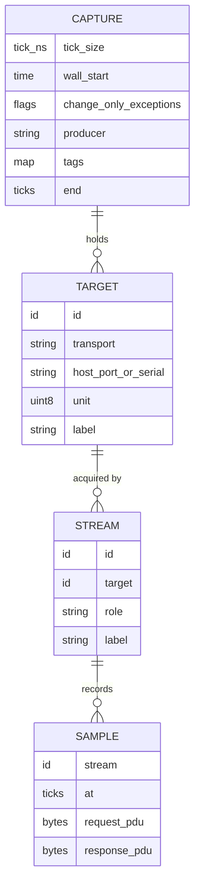

# Concepts

A **capture** records what Modbus devices answered, and when. It is made to be played back: a
virtual device can later host exactly the recorded data to a Modbus client, at the original speed,
slowed down or sped up. This page explains the model every MBCAP file follows, whichever encoding it
is stored in.

## The four records



| Record | What it is | Example |
|---|---|---|
| **Capture** (header) | The file: tick size, wall-clock start, flags, producer, tags, and the capture end | "recorded by modbusctl 3.0.0 on 2026-10-14 13:14:24 UTC, 1 µs ticks" |
| **Target** | One device to host: an endpoint plus a unit id | "Inverter A, TCP 192.168.2.201:502, unit 21" |
| **Stream** | One way a target's data was acquired | "poll plan A, every second", "identity probe" |
| **Sample** | One answered request: stream, time, request PDU, response PDU | "at 1.00045 s: `03 1000 0002` → `03 04 0001 01a7`" |

A target is the thing you replay; a stream is how its data was acquired. A device polled every second,
also polled every minute, and read once for its identity is **one target with three streams**. A simple
capture has one target and one stream.

One file can hold **several targets and streams**, for example a whole site recorded at once. A
consumer can pick out one target or one stream, and `mbcapctl split` writes them to separate files.

## PDUs, not values

A sample stores the raw **request PDU** and **response PDU**: the function code byte followed by its
data, exactly as on the wire. Transport framing (the MBAP header of Modbus/TCP, the CRC of RTU, the LRC
of ASCII) is not stored; a replayer regenerates it for whatever transport it serves.

Values are **never decoded**. A holding register stays an unsigned 16-bit word; there is no scaling,
no data type, no device profile. Consumers bring their own decoders. Because the PDUs are complete,
one record type covers every read function:

| Function | Name | What the response holds |
|---|---|---|
| FC01, FC02 | Read Coils, Read Discrete Inputs | one bit per address |
| FC03, FC04 | Read Holding / Input Registers | one 16-bit word per address |
| FC07 | Read Exception Status | one byte |
| FC08 | Diagnostics (data-returning sub-functions) | echo, diagnostic register, counters |
| FC11, FC12 | Get Comm Event Counter / Log | status, counts, events |
| FC17 | Report Server ID | device-defined bytes |
| FC20 | Read File Record | the records of each sub-request |
| FC24 | Read FIFO Queue | a snapshot of the queue |
| FC43/14 | Read Device Identification | one page of identity objects per sample |

**Captures hold reads only.** The write functions (FC05, 06, 15, 16, 22, 23) are rejected: recording
must never change the device. So are the FC08 sub-functions that change state (restart, listen-only,
clear counters), FC43 with an MEI type other than 14, and every function code not in the table above:
vendor and unknown functions are not supported. A reader reports such a sample as invalid; it never
crashes on one.

## Time

Every sample has one time: the instant the **response was received**, as an integer number of **ticks
since the capture start**. The header holds the tick size (1 µs by default, down to 1 ns) and the
wall-clock time of tick 0.

- Recorders take ticks from a **monotonic clock**, so a wall-clock step during a long capture does not
  distort the intervals.
- Samples of concurrent streams may be stored slightly out of time order. Readers do not assume times
  only increase.
- The header-level **capture end** says how long the last values hold. A file cut short by a crash has
  no recorded end.
- The wall-clock time of a sample is `wall_start + at × tick_ns`. Tools that merge captures from
  several hosts align them on their wall-clock starts; the result is only as good as those hosts' clock
  sync.

## Sample and hold

The data means **sample and hold**: a value is valid from its sample until the next sample of the
same address (or the same request), and whatever happened in between is unknown.

```
register 4097   0x01a7 ─────────────────────┐ 0x01a8 ─────────────────────── (end)
                ▲              ▲            ▲              ▲                 ▲
samples         0 s            1.00045 s    2.0011 s       3.0009 s          4.0008 s
```

- Nothing is **interpolated**. A change between two samples shows at the later sample's time; the
  sampling rate sets the fidelity.
- **Only what was recorded exists.** An address, request or function without a sample is absent. What
  a replayer answers for it is the replayer's choice (for example a Modbus exception); the capture
  never invents data.
- For FC01–04, values are kept **per address**: a client can read any range whose addresses were all
  recorded, even one that was never requested as such. For the other functions they are kept **per
  request**: the response recorded for the same request bytes.
- FC43 device identification is kept **per object**: the pages of a read are merged into one set of
  identity objects.

## Full and change-only captures

| Mode | What is stored | Use |
|---|---|---|
| **Full** (default) | every sample | keeps the poll cadence: you can see how often the device was read |
| **Change-only** | a sample only when its response differs from the previous response to the same request of the same stream | much smaller files for devices that rarely change |

Both replay the same way under sample and hold; change-only loses only the cadence. The capture end is
recorded in both.

## Exception responses

A device may answer with an **exception** (the function code with bit 0x80 set, such as `83 02`,
Illegal Data Address). Exceptions are not hosted data; they are hints about what the device refused.
A capture stores them only when its header says it records exceptions; writers drop them otherwise.

## What may change, and what may not

| Item | Can a consumer override it? |
|---|---|
| Target metadata: address, port, TLS, unit id, transport | **Yes.** The recorded endpoint is a hint; a replayer may serve target 1 as unit 5 on another port |
| Recorded values: registers, coils, identity objects, request and response bytes | **No** |
| Sample times | **No.** Speed is a replay setting; times are never rewritten |

Changing values is an editing operation that writes a **new file** and records itself in the header's
`provenance` tag (see [the CLI](cli.md) and [`edit`](library.md#editing-captures)).

## Crash safety

Writers only append; they never seek back. A recorder that crashes leaves a file that is valid up to its
last complete block: readers return everything before the cut, then report the file as truncated, and
`mbcapctl repair` rewrites it as a complete file. Every block carries a checksum, so damage is detected,
not silently replayed.

## Next

- [Encodings](encodings.md): how the model is stored in binary, JSON Lines and CSV.
- [Getting started](getting-started.md): look inside a capture in a minute.
